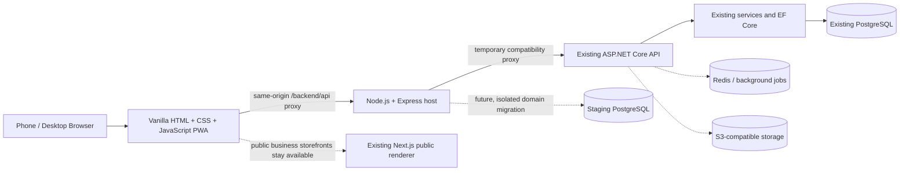

# Avzar

**Avzar is a multi-tenant SaaS platform for fashion designers, tailoring businesses, garment workshops and fashion entrepreneurs.** One workspace per business covers customers and measurements, designs, orders and quotations, invoices and verified payments, workshop production, and a public online storefront.

> **Status: active development, not production-ready.** The owner has selected a **mobile-first PWA built with HTML, CSS, and vanilla JavaScript**, served by a JavaScript Express service. The first PWA shell and a restricted same-origin proxy to the existing ASP.NET API have been added under `pwa/` and `backend-node/`. The existing ASP.NET API and PostgreSQL schema remain authoritative; no production cutover has occurred. Customer/measurement/order/finance/scheduling modules have not yet been migrated to the PWA/Node service. The existing Next.js storefront renderer, MAUI app, and experimental Expo app are retained for reference while their roles are assessed. Dependency installation and end-to-end verification of the new slice remain outstanding. See [Feature inventory](docs/FEATURE_INVENTORY.md), [Architecture](docs/ARCHITECTURE.md), and [Verification and known limitations](#verification-and-known-limitations).

## Who it is for and what it solves

Small fashion businesses typically run on WhatsApp threads, paper measurement books and spreadsheets. That makes measurements easy to lose, prices inconsistent, payments hard to reconcile and production hard to track. Avzar's goal is one system where:

- a customer's measurements are versioned and frozen onto each order;
- prices are calculated server-side from materials, labour and margin rules;
- an invoice is only paid once staff verify the payment evidence;
- a confirmed order generates production tasks that workers act on;
- the business publishes its own storefront from a validated template.

## Module status

| Module | State | Evidence |
|---|---|---|
| Auth, businesses, memberships, roles, permissions, invitations, audit writes | Implemented | Backend suite green in CI |
| Subscription plans and entitlements (Free / Starter / Professional / Business) | Implemented; no payment provider | Backend suite green in CI |
| Customers, measurements, designs, collections, media | Implemented | Backend suite green in CI |
| Orders, quotations (`Quoted` status), pricing calculator | Implemented | Backend suite green in CI |
| Invoices, payments (staff-verified), receipts, credit notes, expenses | Implemented in backend; latest follow-ups unverified | Previous CI run passed; rerun backend tests after current changes |
| Workflows, task generation, assignment, worker actions, alterations | Implemented in source; latest scope/notification changes unverified | Run backend integration tests after current changes |
| Storefront builder API (8 templates, drafts, publish, rollback, presets, DNS-verified domains) and public Next.js renderer | Implemented; **not smoke-tested end to end** | Backend tests and web build in CI |
| Account security: email verification, password reset, TOTP 2FA, JWT + rotating refresh tokens, sessions, export/delete | Implemented | Tests exist; no real email provider exercised |
| Email outbox (SMTP / Resend), S3 storage, ClamAV, Redis rate limits, QuestPDF documents, customer CSV, global search | Implemented | Fakes only; no real service exercised |
| Staff dashboard | **Partially implemented** | Auth, staff/roles/locations, customer workflows, order create/edit/lifecycle and production task list/detail/actions; latest UI changes await CI verification |
| Finance UI | **Partial** | Invoice list, free-form/order-linked creation, draft edit/delete, issue/void, payment actions, credit notes/receipt details, expense records and category management; provider/share flows remain open |
| Business schedule settings | **Initial UI** | Weekly opening hours and closure dates at `/settings`; this is not the production task scheduler or notification system |
| Storefront editor | **Partial** | `/storefront` supports draft content/theme, custom pages, slug/SEO/navigation, section content/style, drag/drop reorder, media picker, template-switch preview, custom-domain DNS verification, preview, publish and rollback; browser E2E remains unverified |
| Customer portal | Partial | Expiring/revocable email-link access to order progress, invoices and verified payments; staging verification remains open |
| Shop and individual-worker scheduling, availability, leave, daily capacity and email reminders | Implemented in source; backend compilation, PostgreSQL integration, migration drift and live provider delivery still require verification | |
| Inventory and stock reservations | Partial | PWA stock management, CSV preview/commit and task-linked reserve/release/consume controls; full verification remains open | |
| Reports | Not built | |
| AI design tools and assistant builder | Not built | |
| Paystack/Flutterwave billing, platform admin | Not built | |
| MAUI starter | Partially implemented | Existing bearer login, assigned tasks, offline action queue and SignalR client; builds/device behavior unverified |
| Experimental Expo mobile app | Reference only; not initial product direction | Source exists but React Native is not part of the agreed PWA-first launch |
| PWA + Node.js/Express | Initial JavaScript slice | `pwa/` provides installable shell, auth UI, and customer list/create/edit/detail against existing API endpoints. `backend-node/` serves it and proxies to ASP.NET. Business routes and Node database access are not migrated; not production-ready |

Per-item detail lives in [PROGRESS.md](PROGRESS.md).

## Architecture



Layers: `Tailoring.Domain` (entities, permissions) → `Tailoring.Application` (service contracts, DTOs, `AppException`) → `Tailoring.Infrastructure` (EF Core, implementations) → `Tailoring.Api` (thin controllers, auth, wiring). Details: [docs/architecture.md](docs/architecture.md).

### Principles

- **Multi-tenancy:** tenant entities carry `BusinessId`, with EF global query filters, a `SaveChanges` write guard and composite foreign keys so PostgreSQL itself rejects cross-business links. The business comes from the signed session, never from the request.
- **Security:** permission checks on every protected endpoint; CSRF header on cookie-authenticated writes (bearer requests exempt); strict storefront layout validation with no user HTML/CSS/JS; images re-encoded; public storefront shows only published, public data.
- **Money:** decimal arithmetic, server-computed totals, idempotency keys, advisory locks, optimistic concurrency. Pending payments count for nothing until verified; financial and audit rows are never deleted.
- **Entitlements:** one catalogue of gates, enforced server-side and failing closed. Downgrades never delete data.

## Repository structure

```
backend/src/Tailoring.{Domain,Application,Infrastructure,Api}
backend/tests/Tailoring.IntegrationTests   PostgreSQL via Testcontainers
pwa/                                       vanilla HTML/CSS/JavaScript installable PWA
backend-node/                               JavaScript + Express host and restricted API proxy
backend/src/Tailoring.{Domain,Application,Infrastructure,Api}  existing authoritative API
mobile/Avzar.Mobile/                       existing MAUI starter (reference; retained)
mobile/avzar-expo/                         experimental Expo source (not initial target)
web/                                       existing Next.js management UI + public storefront renderer
docs/                                      architecture, runbook, feature and migration inventories
scripts/bootstrap-backend.sh               solution + first migration
.github/workflows/                         ci.yml, generate-migration.yml, generate-lockfile.yml
```

## Local development

Prerequisites: .NET SDK 10.0.100+ (`backend/global.json`), Node.js 22, Docker, `dotnet tool install -g dotnet-ef`, and a Six Labors license (ImageSharp 4.x; see RUNBOOK section 8).

```bash
cp .env.example .env                       # set a local password
docker compose up -d postgres
./scripts/bootstrap-backend.sh             # restore and build (migrations are already committed)
cd backend
ConnectionStrings__Default="Host=localhost;Database=tailoring;Username=tailoring;Password=<password>" \
  ASPNETCORE_ENVIRONMENT=Development dotnet run --project src/Tailoring.Api
```

Development auto-migrates and seeds plans. Production must apply migrations explicitly (or set `Database__MigrateOnStartup=true`) and set `Billing__SeedPlansOnStartup=true` once. **Eight migrations are committed** under `backend/src/Tailoring.Infrastructure/Persistence/Migrations` and applied to a clean PostgreSQL by CI; add forward migrations only (see the RUNBOOK) and never regenerate `InitialSchema`. Full steps: [docs/RUNBOOK.md](docs/RUNBOOK.md).

### PWA-first JavaScript slice

The new PWA is served by Express so browser cookies remain same-origin. During migration, set `API_URL` to the existing ASP.NET API; Node does not yet replace its business routes or connect to PostgreSQL.

```bash
cd backend-node
cp .env.example .env
# Edit API_URL in .env to the existing API reachable from this machine
npm install
npm test
npm run dev
```

Open `http://localhost:8081`. The PWA shell can load without the API, but sign-in requires a reachable API. The readiness endpoint returns `200` only when the configured upstream ASP.NET `/health` endpoint is healthy; this does not mean Node has replaced the business API.

### Existing project tests

```bash
cd backend && dotnet test -c Release       # needs Docker
cd web && npm ci && npm run typecheck && npm test && npm run build
```

## Configuration

Set through environment variables or a secret manager; never commit values.

| Variable | Purpose |
|---|---|
| `ConnectionStrings__Default` | PostgreSQL connection |
| `SIXLABORS_LICENSE_KEY` | Build-time ImageSharp license (CI secret) |
| `Pdf__QuestPdfLicense` | Explicit QuestPDF license choice |
| `Auth__JwtSigningKey` | Enables bearer/mobile auth (32+ chars) |
| `Auth__RequireVerifiedEmail` | Optional email-verification gate (default off) |
| `Email__Provider` and provider settings | `log` (default), SMTP or Resend |
| `Storage__Provider`, `Storage__S3__*` | Local disk (default) or S3-compatible |
| `Redis__ConnectionString` | Optional shared rate limits |
| `Billing__SeedPlansOnStartup` | Seed plans once in production |
| `BASE_DOMAIN`, `API_PUBLIC_URL`, `WEB_BASE_URL` | Public hosting |

Persistent ASP.NET Core Data Protection keys are required in production (preview links). Other settings are listed in the RUNBOOK.

## Verification and known limitations

- **Historical CI evidence:** CI run #238 (commit `40306ac`) reported successful backend, web and migration jobs; run #230 recorded a Release backend build with 0 warnings/0 errors and **693/693 tests passed**. These runs predate the newest source changes and are not verification of this exact archive. Historical run #207 applied eight migrations to clean PostgreSQL 17.11 (67 tables, 33 check constraints, 113 foreign keys, 8 partial indexes, no cascading foreign keys on financial/audit tables).
- **Checks on this archive (2026-10-17):** 42/42 dependency-free Node proxy/PWA/readiness tests passed; repository JavaScript syntax checks passed; 160 TypeScript/TSX files passed syntax/transpilation parsing; 13 JSON files parsed successfully. See [`docs/VERIFICATION_REPORT_2026-10-17.md`](docs/VERIFICATION_REPORT_2026-10-17.md) for exact boundaries.
- **Blocked checks:** the full Express integration suite could not run because its dependency installation is incomplete; the web typecheck, Vitest suite and production build could not run because `web/node_modules` is absent and the npm registry is unreachable; .NET build/integration tests and migration drift checks could not run because this workspace has no .NET SDK or PostgreSQL/Docker runtime. Syntax-only TypeScript parsing is not a semantic typecheck.
- **Dependency security:** the committed web lockfile resolves Next.js 15.5.28, React/React DOM 19.3.1, `sharp` 0.35.5 and PostCSS 8.5.30. CI includes blocking high-severity dependency audits; a fresh audit is still required for this exact source archive.
- **Architecture boundary:** the PWA is served by Express with a restricted same-origin proxy to the existing ASP.NET API. PostgreSQL/EF Core and the ASP.NET API remain authoritative. Node has no migrated business-domain repository and must not receive production business traffic as a replacement API.
- **Workflow limitations:** finance provider checkout/share flows, complete offline PWA mutation/synchronization, Web Push/mobile notification delivery, a polished drag-and-drop storefront builder, broad mobile feature parity, and external integration/device testing remain incomplete or unverified. Storefront editing and many finance/inventory/scheduling screens exist in source, but browser/staging workflows still require verification.
- **Security/staging limitations:** no full browser E2E, Docker Compose smoke test, real email delivery, payment provider webhook, S3/ClamAV, Redis/SignalR multi-instance, custom-domain DNS, or physical-device test was run in this workspace.

## Roadmap

1. **First, verify this exact source:** restore locked dependencies, run the full Node suite, web typecheck/tests/build/audit, .NET Release build and integration tests, EF migration drift check, and clean-PostgreSQL migration job; fix all failures found.
2. **Close security/data-isolation gaps:** keep the location-scope dependency required, preserve tenant and location-negative API tests, verify all recent worker/leave/inventory/finance scope changes in PostgreSQL-backed integration tests, and review TOTP/session/authentication edge cases.
3. **Finish workflow gaps:** complete payment-provider checkout/share flows, inventory import/reservation edge cases, schedule conflict and DST behavior, overdue notification delivery/recovery, and storefront editor/media/domain polish.
4. **Complete client migration only deliberately:** Node is still a proxy/static host, not the business API; mobile parity and offline synchronization are not complete. Migrate domain-by-domain only after API-contract, tenant-negative, staging and rollback tests.
5. **Stage before production:** verify publish/rollback and tenant isolation in browser E2E; verify email/payment/storage/DNS/Redis/SignalR integrations and Android/iOS behavior with real configuration and devices. No production cutover is authorized by this archive.

## Documentation

[PROGRESS.md](PROGRESS.md) · [docs/RUNBOOK.md](docs/RUNBOOK.md) · [docs/architecture.md](docs/architecture.md) · [docs/ARCHITECTURE.md](docs/ARCHITECTURE.md) · [docs/FEATURE_INVENTORY.md](docs/FEATURE_INVENTORY.md) · [docs/STATIC_REVIEW.md](docs/STATIC_REVIEW.md) · [mobile/Node migration inventory](docs/MOBILE_NODE_MIGRATION_INVENTORY.md) · [Node API compatibility matrix](docs/NODE_API_COMPATIBILITY_MATRIX.md)

### Storefront management (current web slice)
The signed-in `/storefront` page supports storefront creation from allowed templates, draft editing for page title/slug/SEO/visibility and navigation, custom page add/remove under plan entitlements, section content/style/variant/visibility and ordering, theme settings, private preview, publish/unpublish, version history/rollback, and contact settings. This is still a structured-data editor, not a polished drag-and-drop visual builder; browser E2E and media-picker work remain open. See `docs/MASTER_ENGINEERING_HANDOFF.md` for verification status.

### Business schedule settings
Authorized staff can manage weekly opening hours and closure dates at `/settings`. These settings feed `/tasks/schedule`. The `/workers/schedule` page manages individual worker availability, daily capacity, approved leave and task calendars. The backend queues deduplicated assignment emails and eligible 24-hour reminders through the durable email outbox. Live delivery, full builds and PostgreSQL migration/integration verification remain outstanding; mobile calendar parity is not implemented.

### Finance UI (partial, latest changes await CI)
`/finance` shows invoices, pending payment claims, and expense summaries for the current user's permissions. The PWA now supports free-form and order-linked Full/Deposit/Balance draft creation, draft edit/delete, issue/void, credit notes, payment recording and permission-gated verification/rejection, receipt details, expense records, and expense-category management. Provider-backed invoice checkout and share links remain open; this UI needs a dependency-backed CI run.

### Production scheduling status

The backend includes `POST /api/tasks/schedule/preview` and `POST /api/tasks/schedule/apply`, plus worker-specific availability, approved leave, daily capacity and a location-filtered worker calendar. Preview is gated by `tasks.view`; apply requires `tasks.manage`; both require `scheduling.shop`. Apply recalculates the plan, checks task row versions and exact slots, rejects stale/partial plans, persists schedule events transactionally and queues deduplicated assignment/reminder emails. The latest changes have not been compiled or tested against PostgreSQL because the .NET SDK and Docker are unavailable in the working environment. See `docs/production-scheduling.md`.


### Production schedule preview

Users with task-view access can open `/tasks/schedule` to request a proposed shop schedule. The preview is entitlement-gated by the API and does not persist planned times. See [`docs/production-scheduling.md`](docs/production-scheduling.md) for limitations and verification status.

### Shop schedule apply increment (2026-10-16)
- Added `POST /api/tasks/schedule/apply`, gated by `tasks.manage` and `scheduling.shop` entitlement.
- Preview responses now include task row versions. Apply recalculates server-side, rejects stale candidate sets/versions and partial schedules, then saves planned times transactionally with `schedule_applied` task events.
- The web schedule screen now offers Apply only when every candidate is schedulable and submits the preview's version map; stale plans must be regenerated.
- Superseded by the latest increment recorded in `PROGRESS.md` and `docs/production-scheduling.md`: worker availability/leave/capacity and email outbox reminders are now implemented in source, but verification is still blocked.
- Verification remains incomplete: .NET SDK and npm dependencies are unavailable in this environment; no backend compile/integration tests or full web build/tests were run for this increment.

## Roadmap increment: inventory, reports, customer portal, AI, billing and mobile

This source increment adds the following API surfaces:

- `GET/POST /api/inventory`, `POST /api/inventory/{id}/{receive|adjust|reserve|release|consume}`, `GET /api/inventory/{id}/movements`, CSV preview/commit import and export, plus atomic `POST /api/inventory/tasks/{taskId}/reserve` and `/consume` batches. Customer CSV import/export now has a web UI with preview, duplicate handling and confirmation.
- `GET /api/reports/summary?from=YYYY-MM-DD&to=YYYY-MM-DD` with tenant and location-scoped totals.
- `POST /api/customer-portal/customers/{customerId}/link`, `DELETE .../links`, and public `GET /api/customer-portal/access/{token}`.
- `POST /api/ai/fashion-design` and `POST /api/ai/assistant-builder` (OpenAI provider configuration required; plan entitlements gate each feature).
- `POST /api/billing/subscription/checkout` and anonymous signature-verified `POST /api/billing/subscription/webhook` (Paystack; NGN plans only).
- `GET/PUT /api/platform-admin/plans` for allowlisted platform-admin emails configured under `PlatformAdmin:Emails`.
- Authenticated SignalR hub at `/hubs/business-events` (business-scoped group; worker task transitions publish `task.updated`).
- .NET MAUI starter at `mobile/Avzar.Mobile/` for Android/iOS.

Configure `AI__OpenAI__ApiKey`, `Billing__Paystack__SecretKey`, `Billing__Paystack__CallbackUrl`, `Redis__ConnectionString`, and `PlatformAdmin__Emails__0` in the hosting environment as applicable. Never commit real secrets. Configure the Paystack webhook URL as `https://<api-host>/api/billing/subscription/webhook`. The Paystack callback page is a return path only; the server activates a plan only after independently verifying a signed provider webhook. Read `docs/VERIFICATION_REPORT_2026-10-16_ROADMAP.md`: this increment has not yet been compiled or tested against PostgreSQL in the current environment.
