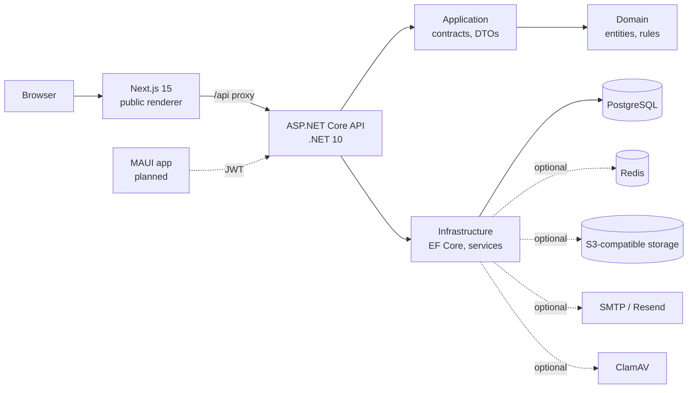

# Avzar

**Avzar is a multi-tenant SaaS platform for fashion designers, tailoring businesses, garment workshops and fashion entrepreneurs.** One workspace per business covers customers and measurements, designs, orders and quotations, invoices and verified payments, workshop production, and a public online storefront.

> **Status: active development, not production-ready.** The backend and storefront renderer are substantially built. The staff dashboard, visual storefront editor, scheduling, notifications, AI, billing, platform admin and mobile app are **not built yet**. Each claim below is tagged with its evidence level. See [Verification and known limitations](#verification-and-known-limitations).

## Who it is for and what it solves

Small fashion businesses typically run on WhatsApp threads, paper measurement books and spreadsheets. That makes measurements easy to lose, prices inconsistent, payments hard to reconcile and production hard to track. Avzar's goal is one system where:

- a customer's measurements are versioned and frozen onto each order;
- prices are calculated server-side from materials, labour and margin rules;
- an invoice is only paid once staff verify the payment evidence;
- a confirmed order generates production tasks that workers act on;
- the business publishes its own storefront from a validated template.

## Module status

| Module | State | Evidence |
|---|---|---|
| Auth, businesses, memberships, roles, permissions, invitations, audit writes | Implemented | Backend suite green in CI |
| Subscription plans and entitlements (Free / Starter / Professional / Business) | Implemented; no payment provider | Backend suite green in CI |
| Customers, measurements, designs, collections, media | Implemented | Backend suite green in CI |
| Orders, quotations (`Quoted` status), pricing calculator | Implemented | Backend suite green in CI |
| Invoices, payments (staff-verified), receipts, credit notes, expenses | Implemented | Backend suite green in CI |
| Workflows, task generation, assignment, worker actions, alterations | Implemented | Backend suite green in CI |
| Storefront builder API (8 templates, drafts, publish, rollback, presets, DNS-verified domains) and public Next.js renderer | Implemented; **not smoke-tested end to end** | Backend tests and web build in CI |
| Account security: email verification, password reset, TOTP 2FA, JWT + rotating refresh tokens, sessions, export/delete | Implemented | Tests exist; no real email provider exercised |
| Email outbox (SMTP / Resend), S3 storage, ClamAV, Redis rate limits, QuestPDF documents, customer CSV, global search | Implemented | Fakes only; no real service exercised |
| Staff dashboard and visual storefront editor | **Not built** | Only the public renderer and `/preview` exist in `web/` |
| Customer portal | Not built | |
| Scheduling engine and daily plans, notifications, SignalR, background-job hardening | Not built | |
| Inventory and stock reservations | Not built | |
| Reports | Not built | |
| AI design tools and assistant builder | Not built | |
| Paystack/Flutterwave billing, platform admin | Not built | |
| .NET MAUI mobile and offline sync | Not built | |

Per-item detail lives in [PROGRESS.md](PROGRESS.md).

## Architecture



Layers: `Tailoring.Domain` (entities, permissions) → `Tailoring.Application` (service contracts, DTOs, `AppException`) → `Tailoring.Infrastructure` (EF Core, implementations) → `Tailoring.Api` (thin controllers, auth, wiring). Details: [docs/architecture.md](docs/architecture.md).

### Principles

- **Multi-tenancy:** tenant entities carry `BusinessId`, with EF global query filters, a `SaveChanges` write guard and composite foreign keys so PostgreSQL itself rejects cross-business links. The business comes from the signed session, never from the request.
- **Security:** permission checks on every protected endpoint; CSRF header on cookie-authenticated writes (bearer requests exempt); strict storefront layout validation with no user HTML/CSS/JS; images re-encoded; public storefront shows only published, public data.
- **Money:** decimal arithmetic, server-computed totals, idempotency keys, advisory locks, optimistic concurrency. Pending payments count for nothing until verified; financial and audit rows are never deleted.
- **Entitlements:** one catalogue of gates, enforced server-side and failing closed. Downgrades never delete data.

## Repository structure

```
backend/src/Tailoring.{Domain,Application,Infrastructure,Api}
backend/tests/Tailoring.IntegrationTests   PostgreSQL via Testcontainers
web/                                       Next.js 15 public storefront renderer
docs/                                      architecture, runbook, static review
scripts/bootstrap-backend.sh               solution + first migration
.github/workflows/                         ci.yml, generate-migration.yml
```

## Local development

Prerequisites: .NET SDK 10.0.100+ (`backend/global.json`), Node.js 22, Docker, `dotnet tool install -g dotnet-ef`, and a Six Labors license (ImageSharp 4.x; see RUNBOOK section 8).

```bash
cp .env.example .env                       # set a local password
docker compose up -d postgres
./scripts/bootstrap-backend.sh             # restore, build, create migration
cd backend
ConnectionStrings__Default="Host=localhost;Database=tailoring;Username=tailoring;Password=<password>" \
  ASPNETCORE_ENVIRONMENT=Development dotnet run --project src/Tailoring.Api
```

Development auto-migrates and seeds plans. Production must apply migrations explicitly (or set `Database__MigrateOnStartup=true`) and set `Billing__SeedPlansOnStartup=true` once. **No migration is committed yet** (the repository has no `Migrations` folder); the schema is currently generated by the bootstrap script and the CI check. Decide on a baseline before any shared deployment. Full steps: [docs/RUNBOOK.md](docs/RUNBOOK.md).

### Tests

```bash
cd backend && dotnet test -c Release       # needs Docker
cd web && npm install && npm run typecheck && npm test && npm run build
```

## Configuration

Set through environment variables or a secret manager; never commit values.

| Variable | Purpose |
|---|---|
| `ConnectionStrings__Default` | PostgreSQL connection |
| `SIXLABORS_LICENSE_KEY` | Build-time ImageSharp license (CI secret) |
| `Pdf__QuestPdfLicense` | Explicit QuestPDF license choice |
| `Auth__JwtSigningKey` | Enables bearer/mobile auth (32+ chars) |
| `Auth__RequireVerifiedEmail` | Optional email-verification gate (default off) |
| `Email__Provider` and provider settings | `log` (default), SMTP or Resend |
| `Storage__Provider`, `Storage__S3__*` | Local disk (default) or S3-compatible |
| `Redis__ConnectionString` | Optional shared rate limits |
| `Billing__SeedPlansOnStartup` | Seed plans once in production |
| `BASE_DOMAIN`, `API_PUBLIC_URL`, `WEB_BASE_URL` | Public hosting |

Persistent ASP.NET Core Data Protection keys are required in production (preview links). Other settings are listed in the RUNBOOK.

## Verification and known limitations

- **CI run #115** (2026-10-16): the `migrations` job succeeded. Its log shows all three committed migrations applied to a clean PostgreSQL 17.11 and a schema of 65 tables, 33 check constraints, 112 foreign keys and 6 partial indexes, with no cascading foreign keys on financial or audit tables. The backend TRX supplied for it reports **560/560 tests passed**; the TRX does not record its run id. The `backend` job also runs a license gate (fails on an empty `SIXLABORS_LICENSE_KEY`), `dotnet ef migrations has-pending-model-changes` and the Release build; the `web` job runs `npm install`, `typecheck`, `test`, `build`. The `backend` and `web` results of #115 were not individually inspected.
- Run #114 failed one test (multipart upload endpoints returned 415 to an anonymous JSON probe); this was a test bug and is fixed.
- **Not verified:** `docker compose` startup; full-stack smoke test; storefront publish-to-render; email, S3, ClamAV, Redis, DNS and every other external integration; mobile. There is no staff dashboard or storefront editor yet.
- CI warns that actions targeting Node.js 20 (seen for `checkout@v4` and `setup-dotnet@v4`; `setup-node@v4` and `upload-artifact@v4` are on the same major) are forced onto Node 24. Upgrade after checking for compatible newer majors.
- Known design issues: the public site's `frame-ancestors 'none'` will block the editor's preview iframe; nonce CSP makes public pages dynamic (not CDN-cacheable).

## Roadmap

Planned, in rough priority order (none implemented unless marked above):

1. Verified baseline: migrations applied to a clean PostgreSQL (done in CI), authorization tests via `WebApplicationFactory` (done); still to do: compose smoke test.
2. Remaining Step A gaps: email webhooks, Redis caching/queues/SignalR backplane, more CSV import/export, location scoping for customers/expenses/reports, background-job recovery. (Audit-read, TOTP replay protection, join-with-existing-account, ownership transfer, PDF branding and location scoping of orders, finance and tasks are implemented and covered by the passing suite.)
3. Staff dashboard and visual storefront editor (with Playwright tests).
4. Scheduling, inventory, notifications, reports.
5. Customer portal, billing, platform admin, AI tools, mobile.

## Documentation

[PROGRESS.md](PROGRESS.md) · [docs/RUNBOOK.md](docs/RUNBOOK.md) · [docs/architecture.md](docs/architecture.md) · [docs/STATIC_REVIEW.md](docs/STATIC_REVIEW.md)
