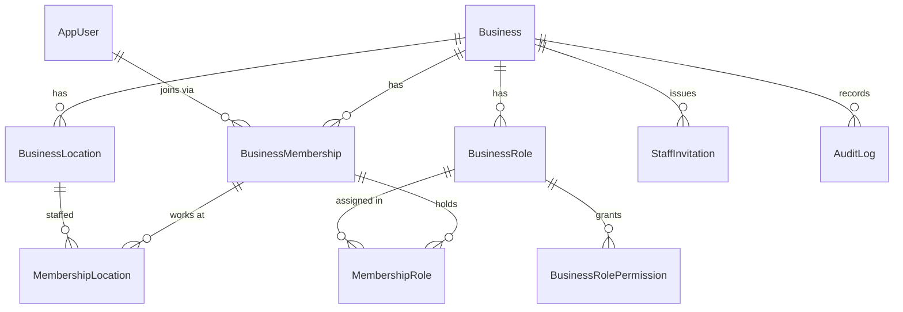
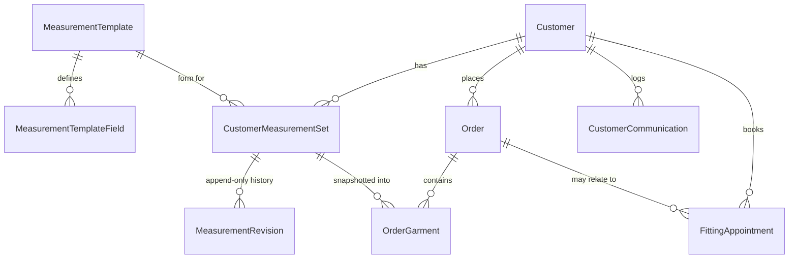
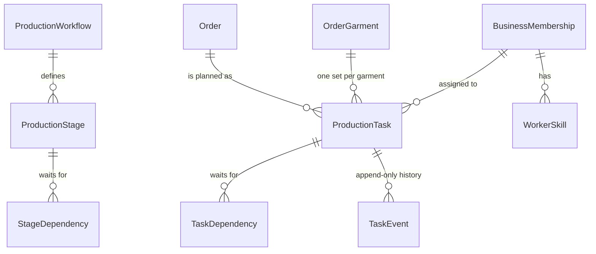

# Architecture - Tailoring Platform

Status (2026-10-15): backend verification artifacts supplied with the source snapshot report 478/478 tests passed and include a generated EF migration. They have not been independently rerun here; branch freshness, live CI provenance, and deployment readiness remain unverified. See `PROGRESS.md`.

## 1. Stack and versions
| Layer | Choice | Pinned in |
|---|---|---|
| Backend | C# / ASP.NET Core Web API, EF Core, ASP.NET Core Identity, .NET 10 | `backend/Directory.Packages.props` |
| Database | PostgreSQL 17 (Npgsql EF provider) | `docker-compose.yml` |
| Realtime / jobs | SignalR, Hangfire (Postgres storage) | Phase 5 |
| Web | Next.js (App Router), TypeScript, Tailwind, React Hook Form + Zod | Phase 1b/2 |
| Mobile | .NET MAUI (Android + iOS), FCM | Phase 7 |

**Package versions are pinned in `backend/Directory.Packages.props`, but current compatibility and vulnerability status are not verified by this workspace.** Run `dotnet restore`, Release build, and a current dependency/advisory scan before release. ImageSharp 4.1.2 requires `SIXLABORS_LICENSE_KEY`; QuestPDF requires an explicit `Pdf__QuestPdfLicense` choice.

## 2. Backend layering
```
Tailoring.Domain          entities, permission catalogue, default roles (no dependencies)
Tailoring.Application     service interfaces, DTOs, AppException, ITenantContext (depends on Domain)
Tailoring.Infrastructure  EF Core DbContext, Identity, service implementations (Application + Domain)
Tailoring.Api             controllers, authN/authZ wiring, middleware (Application + Infrastructure)
```
Controllers contain no business logic. The scheduling engine (Phase 4) will be pure C# in Application/Domain with no EF dependency so it can be unit tested.

## 3. Tenant isolation (defence in depth)
1. **Source of truth for "which business"**: a `business_id` claim in the signed session cookie, set at login. Never read from a body, query string, or header.
2. **Global EF query filters** on every `ITenantScoped` entity: `BusinessId == CurrentBusinessId`. With no tenant in scope, tenant tables return nothing.
3. **Write guard** in `SaveChanges`: with a tenant in scope, adding/modifying/deleting another business's row throws; new rows are stamped with the current business.
4. **Database constraints**: every tenant table has a FK to `Businesses`. Link tables use composite FKs `(X_Id, BusinessId)` to alternate keys `(Id, BusinessId)`, so PostgreSQL itself rejects a membership linked to another business's role or location.
5. **Tests** (`TenantIsolationTests`) hit a real PostgreSQL container for each layer above.

Known gap, by design: code that runs with **no tenant** (registration, invitation acceptance, Hangfire jobs) bypasses filters and must set `BusinessId` explicitly and use `IgnoreQueryFilters()` deliberately. Every such call site is greppable. Background jobs in Phase 5 will receive a business id and set a scoped tenant context.

## 4. Authentication and permissions
- **Web**: ASP.NET Core Identity password hashing, lockout (5 attempts / 15 min), HttpOnly + SameSite=Lax cookie (`Secure` outside Development). No tokens in localStorage.
- **CSRF**: antiforgery with header `X-XSRF-TOKEN`, validated automatically on unsafe methods. `GET /api/auth/csrf` issues the token; re-fetch after login/logout. Next.js should proxy `/api/*` to the backend so the app and API are same-origin.
- **Rate limiting**: 10/min per IP on register, login, accept-invitation. Behind a reverse proxy, configure forwarded headers or all clients share one IP.
- **Permissions**: `[HasPermission("staff.manage")]` -> dynamic policy -> `PermissionHandler` queries the user's *current active membership and roles* each request (cached per request). Deactivation and role changes apply immediately. Owner holds all permissions. Users can hold several roles; permissions are the union.
- **Mobile (Phase 7)**: separate bearer-token flow (short-lived access token, rotating refresh token stored hashed, revocation, MAUI SecureStorage). Not built yet.

## 5. Phase 1 data model

All tenant tables carry `BusinessId`. Timestamps are UTC. `Business.Version` maps to PostgreSQL `xmin` for optimistic concurrency.

### Entities by phase
| Phase | Entities |
|---|---|
| 1 | Business, BusinessLocation, BusinessRole(+Permission), BusinessMembership, MembershipRole, MembershipLocation, StaffInvitation, AuditLog |
| 2 | Customer, MeasurementTemplate(+Field), CustomerMeasurement (versioned), Order, OrderGarment, GarmentSpecification, Attachment, FittingAppointment |
| 3 | ProductionWorkflow, ProductionStage, ProductionTask, TaskDependency, task history |
| 4 | WorkerProfile, WorkerSkill, WorkerAvailability, WorkerLeave, WorkSchedule, ScheduleEntry, SchedulePublication, ScheduleRevisionHistory |
| 5 | Notification, NotificationPreference, NotificationDeliveryAttempt, DeviceRegistration, outbox |
| 6 | InventoryItem, StockMovement, MaterialReservation, Supplier, Invoice, Payment, Expense |
| 8+ | Storefront module, subscriptions, platform admin |

## 6. Phase 1 API
Auth: `GET /api/auth/csrf`, `POST /api/auth/register-business`, `/login`, `/accept-invitation`, `/logout`, `GET /api/auth/me`.
Staff (`staff.view` / `staff.manage`): `GET /api/staff`, `POST /api/staff/invitations`, `POST /api/staff/{id}/deactivate|reactivate`, `PUT /api/staff/{id}/roles|locations`.
Roles (`roles.manage`): `GET /api/roles`, `GET /api/roles/permissions`, `POST /api/roles`, `PUT /api/roles/{id}/permissions`.
Locations: `GET /api/locations`, `POST /api/locations` (`locations.manage`). Staff without `locations.all` (and who are not the owner) only see orders and fittings at the locations assigned to them; see `ILocationScope`.
Errors are RFC 7807 problem responses with a stable `code` field. Swagger UI at `/swagger` in Development.

Business rules enforced: the Owner cannot be deactivated or have roles changed; the Owner role cannot be edited or assigned by invitation; users cannot deactivate themselves; role/location ids in requests must belong to the caller's business; invitations store only a SHA-256 hash of the token and expire after 7 days.

## 7. Decisions that need your confirmation
1. **.NET 10** as the target (current LTS). Say so if you need .NET 8/9.
2. **Cookie auth for web, separate token auth for mobile**, rather than one scheme for both.
3. **Email is currently logged, not sent.** Real SMTP/provider arrives with the outbox in Phase 5.
4. **Joining with an existing account** (one person, several businesses) via invitation is not built. The data model supports it.


---
# Phase 2 - Customers, measurements, orders

## Data model additions

Every link above is a composite FK `(X_Id, BusinessId)`, so a customer, measurement profile, order or fitting can never point at another business's row, even if application code is wrong.

## Rules enforced on the server
**Customers**
- Search (name/email/phone, wildcard-safe), status filter, sort, pagination. Merged profiles are hidden unless asked for.
- Creating or changing an email/phone that matches an existing customer returns **409 `possible_duplicate`** with candidates. The client resubmits with `allowDuplicate: true` to override.
- **Merge** (`customers.merge`): moves orders, measurement profiles (renaming clashing labels), communications and fittings to the survivor, fills its empty contact fields, and keeps the source as `Merged` with a pointer to the survivor. Atomic.
- Updates need the current `version` (optimistic concurrency); a stale one returns 409 `stale_version`.

**Measurements**
- A template is a garment category's form (Shirt, Trousers, ...). Six starter templates are created per business; owners add their own. Fields have key, label, unit (cm/mm/in/kg/lb), min/max and required.
- Values are validated against the template: unknown keys, missing required fields, out-of-range values and more than 2 decimals are rejected with a message naming each problem.
- A customer profile (e.g. "Wedding suit 2026") is **append-only**: each save adds a full revision recording who and when. Values carry their own label/unit, so history stays readable if the template is later edited. Revisions can be compared.

**Orders**
- Totals are computed only on the server: line = quantity x unit price (2 dp, half away from zero), subtotal = sum of lines, total = subtotal - discount. Clients cannot send totals. A PostgreSQL check constraint also enforces `total = subtotal - discount`.
- Currency is copied from the business at creation and never changes.
- Order numbers (`ORD-2026-00042`) come from an atomic per-business/year counter inside the order's transaction.
- **Measurement snapshot**: each garment can reference a customer profile (which must belong to the order's customer). The chosen revision is copied into the line as frozen JSON. Later re-measuring never alters it. Editing an order keeps existing snapshots unless the caller explicitly picks a different profile or revision.
- **Idempotency**: send `Idempotency-Key` on create. A retry (even a concurrent one) returns the original order with 200 instead of creating a duplicate.
- Lifecycle: `Draft -> Quoted -> Confirmed`, or `Cancelled` (reason required). Editing a Quoted order sends it back to Draft so a changed price must be re-quoted. Confirmed/Cancelled orders are locked.
- Confirming requires `orders.confirm`, a future promised date (in the business's time zone) and an active customer.

## Phase 2 API
Customers: `GET/POST /api/customers`, `GET/PUT /api/customers/{id}`, `POST .../status`, `POST /api/customers/{source}/merge-into/{target}`, `GET/POST .../communications`, `GET/POST .../measurements`.
Measurements: `GET/POST /api/measurement-templates`, `GET/PUT .../{id}`, `POST /api/measurement-sets/{id}/revisions`, `GET .../history`, `GET .../compare?from=&to=`.
Orders: `GET/POST /api/orders` (Idempotency-Key header), `GET/PUT /api/orders/{id}`, `POST .../quote`, `.../confirm`, `.../cancel`.
Fittings: `GET/POST /api/fittings`, `POST /api/fittings/{id}/status`.

New permissions: `customers.view|manage|merge`, `measurements.templates|record`, `orders.view|manage|confirm`, `fittings.manage`. Manager gets all of them. **Tailor/Cutter/Finisher/QC get none on purpose**: workers must not see customer personal data. They get task-level access in Phase 3/4.

## Deliberately NOT in Phase 2
- **Payments, deposits, outstanding balance, invoices** -> Phase 6. Orders have totals but no payment records yet, so "paid / outstanding" does not exist yet and nothing pretends it does.
- **Photo and design-reference uploads** -> need object storage and the secure attachment pipeline (planned with Phase 5/6).
- **Customer notifications** (fitting reminders, status updates) -> Phase 5. Communication log entries are manual for now.
- **Production tasks on confirm** -> Phase 3. `ConfirmAsync` has a marked hook for it.
- **Location-restricted staff** (a manager only seeing their own workshop's orders): the data model supports it; enforcement is not built.
- **Separate `GarmentSpecification` table**: specs live as columns on the order line (fabric, colour, style, alteration notes). Split it out only if specs need their own versioning.
- **Phone matching** is digits-only, so `+234 803...` and `0803...` are not treated as the same number.


---
# Phase 3 - Production workflows, tasks, dependencies, assignment

## Model

Tasks copy what they need from the stage (name, skill, checklist, minutes) and keep only an informational `StageId`. Editing a workflow later never rewrites tasks that already exist. All links are composite tenant FKs, as before, and the database also rejects a task that depends on itself.

## How it works
- **Workflows** are per business. Stages have prerequisites (a graph, validated for cycles), an optional required skill, a default duration (minutes per piece), a completion checklist, and can be *conditional*. A default workflow with the ten spec stages is created at registration. Which workflow a garment uses: explicit choice at generation, else a workflow whose categories match the garment's category, else the default. Exactly one default per business (DB-enforced).
- **Generation** happens automatically when an order is confirmed, in the same transaction, so an order is never confirmed without its tasks. One task per stage per garment; quantity scales the estimate; deadline = end of the promised day in the business time zone; priority is inherited. If a stage has no default duration the estimate stays empty and the task is flagged `needsEstimate` (nothing is invented). `POST /api/orders/{id}/generate-tasks` plans garments that were missed; garments that already have tasks are skipped, so it is safe to repeat.
- **Conditional steps** (Alterations) are generated as *Cancelled / "not required"*. Cancelled counts as satisfied, so Final QC is not held up. When the step before it (the fitting) is completed with `alterationsRequired`, or a manager calls `request-alterations`, the step is re-opened, Final QC then waits for it, and the notes are added to the garment.
- **Eligibility** is computed, not stored: a task is eligible when it is Pending/Scheduled, every prerequisite is Completed or Cancelled, and the order is Confirmed or InProduction.
- **Overdue** is also computed: open (not Completed/Cancelled) and past its deadline. It is never a stored status.
- **Order status follows the tasks**: Confirmed -> InProduction when work starts; -> Ready when every active task is complete; back to InProduction if a task is added or reopened. `Delivered` is an explicit action that refuses unless the order is Ready and no task is open. Orders can be edited only while Draft/Quoted. Cancelling an order cancels its open tasks.
- **Progress** (total / completed / in progress / blocked / overdue / percent) is derived on each order read.

## Worker actions (`/api/my/tasks`, permission `tasks.work`)
Every call loads the task *through the caller's own membership*, so someone else's task looks like it does not exist. Start requires Pending/Scheduled, an active order, all prerequisites done, and no other task in progress for that worker. Pause/Resume, Complete (every checklist item must be ticked), and Report issue (missing materials, defect, clarification, other: blocks the task and records who/why). Blocked tasks are released by a manager (`unblock`); work that had started comes back as Paused. Concurrent double-taps are caught by optimistic concurrency (409).
Worker responses never include the customer's name or contact details. They do include the garment spec and frozen measurement snapshot, which a tailor needs.

## Assignment and overrides (managers)
- Assigning checks the worker is an active member, has the task's required skill, and is assigned to the order's workshop. A mismatch returns **409 `assignment_not_allowed`** listing the problems.
- Forcing it needs `override: true`, a written reason (5+ characters) **and** the `tasks.override` permission. It is recorded in the task history and the audit log. Workers cannot assign themselves: assigning needs `tasks.assign`, which workers do not have.
- `POST /api/tasks/{id}/override` (`Start` or `Complete`) is the only way past dependencies or the checklist. It needs the same permission, a reason, and an assignee, and is audited.
- Tasks can be reassigned while Pending/Scheduled/Paused/Blocked, not while In Progress (pause first).

## Phase 3 API
Workflows: `GET/POST /api/workflows`, `GET/PUT /api/workflows/{id}`.
Manager tasks: `GET /api/tasks` (filters: status, order, garment, assignee, unassigned, overdue, eligible, stage, priority, due-before), `GET/PUT /api/tasks/{id}`, `POST .../assign|unblock|cancel|override`, `POST /api/orders/{id}/tasks` (ad-hoc), `POST /api/orders/{id}/generate-tasks`, `POST /api/orders/{id}/deliver`, `POST /api/order-garments/{id}/request-alterations`.
Worker: `GET /api/my/tasks`, `GET .../{id}`, `POST .../start|pause|resume|complete|issues`.
Workers: `GET /api/workers`, `PUT /api/workers/{membershipId}/skills`.
New permissions: `tasks.view|manage|assign|override|work`, `workflows.manage`, `workers.manage`. Manager gets all; Tailor/Cutter/Finisher/QC get `tasks.work` only.

## Deliberately NOT in Phase 3
- **Planned start/end times, daily schedules, availability, leave, double-booking checks, the scheduling engine** -> Phase 4. The columns `PlannedStartUtc/PlannedEndUtc` exist but nothing sets them; the `Scheduled` status exists but nothing uses it yet. A worker's task list is ordered by priority then deadline until then.
- **Notifications** (new assignment, blocked task, newly eligible next step) -> Phase 5. Task history records everything needed; `Completed` events carry `newlyEligible` task ids for that purpose.
- **Materials**: tasks hold a free-text requirement list (name/quantity/unit). Reservations and "missing material" shortage handling against stock arrive with inventory in Phase 6. A worker can already report missing materials, which blocks the task.
- **Progress photos / attachments** -> needs object storage.
- **Order amendments** after confirmation (changing a confirmed order's garments) -> not built; confirmed orders are locked.
- **Worker "skills" are free text** typed by managers (lowercase). There is no skill catalogue or qualification expiry.
- **Offline/mobile conflict handling** -> Phase 7.
